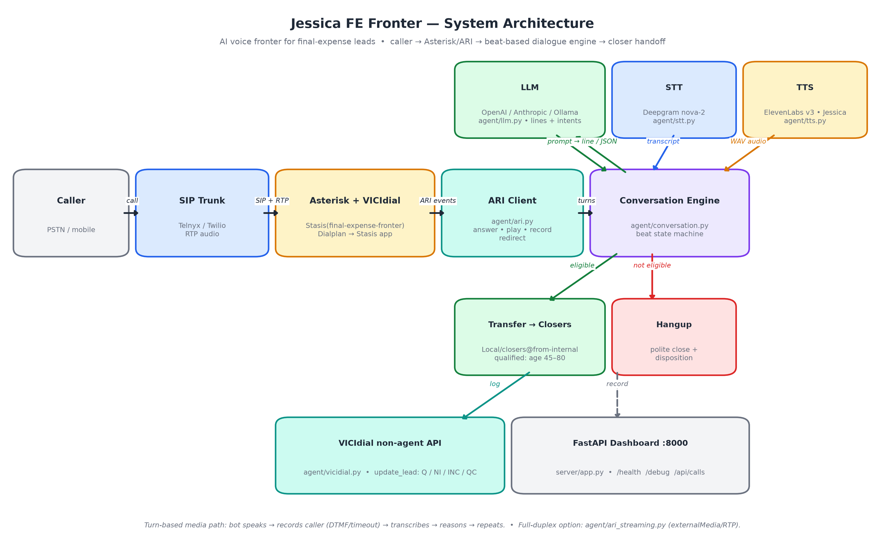
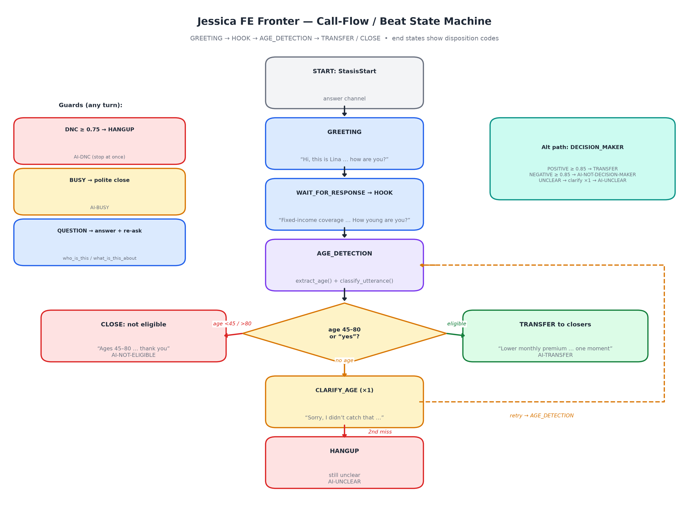
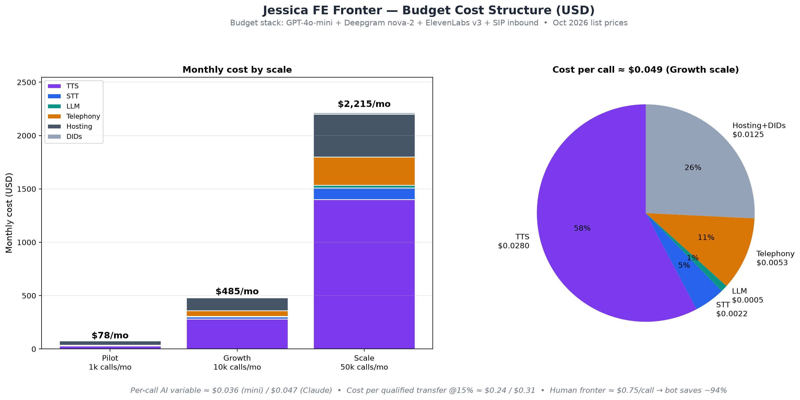

# Jessica FE Fronter — Budget Cost Structure (USD)

> Priced from public list prices checked **October 2026**. Assumes the production stack:
> **LLM** (GPT-4o-mini *or* Claude Sonnet) + **Deepgram nova-2** STT + **ElevenLabs v3 (Jessica)** TTS
> + **Asterisk/VICIdial** on a VPS + **SIP trunk** for the fronter leg.
> Debug mode (`python cli.py debug`) costs **$0** — no PBX, no API keys.

## 1. Scientific diagrams

### 1.1 System architecture



*Caller → SIP trunk → Asterisk/VICIdial (Stasis app) → ARI client → beat-based conversation
engine (LLM + STT + TTS) → transfer to closers / hangup + disposition → VICIdial API + dashboard.*

### 1.2 Call-flow / beat state machine



*GREETING → HOOK → AGE_DETECTION → TRANSFER / CLOSE, with DNC / BUSY / QUESTION guards and
disposition codes (`AI-TRANSFER`, `AI-NOT-ELIGIBLE`, `AI-DNC`, `AI-BUSY`, `AI-UNCLEAR`).*

### 1.3 Budget charts



---

## 2. Usage assumptions (per call)

Measured against the actual dialogue in `agent/conversation.py` (greeting → hook → age check → handoff/close):

| Resource | Assumption | Basis |
|---|---|---|
| Bot speech (TTS) | **~350 chars/call** (~3 short lines) | greeting + hook + handoff/close line |
| Caller audio (STT) | **~0.5 billable min/call** (2 short turns) | turn-based `record → transcribe` path |
| LLM tokens | **~2,500 in / ~250 out** (~4 calls: 3 lines + 1 classifier) | persona + beat prompts + classifier JSON |
| Fronter call leg | **~1.5 min/call** (inbound DID) | answer → qualify → transfer/hangup |
| Qualification rate | **~15%** reach `AI-TRANSFER` | planning figure — replace with measured rate |

## 3. Unit prices (Oct 2026 list)

| Component | Price | Source |
|---|---|---|
| ElevenLabs v3 TTS | **$0.08 / 1k chars** (range $0.08–0.10) | [Cartesia: ElevenLabs pricing 2026](https://www.cartesia.ai/learn/elevenlabs-pricing) |
| Deepgram nova-2 STT | **$0.0043 / min** | [Deepgram: Nova-2](https://deepgram.com/learn/nova-2-speech-to-text-api) |
| GPT-4o-mini | **$0.15 / $0.60 per 1M** (in/out) | [ClawRouters: GPT-4o-mini pricing 2026](https://www.clawrouters.com/blog/gpt-4o-mini-api-pricing-2026) |
| Claude Sonnet class | **$3 / $15 per 1M** (in/out) | [PricePerToken: Sonnet 4.5](https://pricepertoken.com/pricing-page/model/anthropic-claude-sonnet-4.5) |
| SIP inbound (Telnyx) | **from $0.0032 / min**, DIDs **$1 / mo** | [Telnyx vs Twilio 2026](https://www.sipnex.ca/blog/telnyx-vs-twilio) |
| SIP outbound (Telnyx) | **from $0.005 / min** (Twilio $0.010) | [Telnyx vs Twilio 2026](https://www.sipnex.ca/blog/telnyx-vs-twilio) |
| VPS (self-hosted) | **$40–120 / mo** all-in-one | [VICIfast pricing](https://vicifast.com/pricing) |
| Managed VICIdial | **from $49 / mo** (VICIfast) / $400 + $1,000 setup (VICIhost) | [VICIfast](https://vicifast.com/pricing), [VICIdial pricing guide](https://sourceforge.net/p/vicistack/blog/2026/04/vicidial-pricing-guide-295/) |

## 4. Cost per call (variable AI + telephony)

| Cost element | Budget stack (GPT-4o-mini) | Premium stack (Claude Sonnet) |
|---|---|---|
| TTS: 350 chars × $0.08/1k | $0.0280 | $0.0280 |
| STT: 0.5 min × $0.0043 | $0.0022 | $0.0022 |
| LLM: 2.5k in / 0.25k out | $0.0005 | $0.0113 |
| Telephony: 1.5 min × ~$0.0035 | $0.0053 | $0.0053 |
| **Total per call** | **≈ $0.036** | **≈ $0.047** |

> 💡 **TTS dominates (~60–75%)** — voice cost is the #1 lever (see §8).

## 5. Monthly budget by scale

Fixed base: VPS hosting + DIDs. (Optional DNC scrubbing ~$150–300/mo and sysadmin time not included.)

### 5a. Budget stack (GPT-4o-mini)

| Line item / mo | Pilot: 1k calls (~33/day) | Growth: 10k calls (~333/day) | Scale: 50k calls (~1.7k/day) |
|---|---|---|---|
| TTS | $28 | $280 | $1,400 |
| STT | $2 | $22 | $110 |
| LLM | $1 | $5 | $25 |
| Telephony | $5 | $53 | $265 |
| Hosting (VPS) | $40 | $120 | $400 |
| DIDs | $2 | $5 | $15 |
| **Total** | **≈ $78 / mo** | **≈ $485 / mo** | **≈ $2,215 / mo** |

### 5b. Premium stack (Claude Sonnet)

| Line item / mo | Pilot: 1k calls | Growth: 10k calls | Scale: 50k calls |
|---|---|---|---|
| AI + telephony variable | $47 | $468 | $2,340 |
| Hosting + DIDs | $42 | $125 | $415 |
| **Total** | **≈ $89 / mo** | **≈ $593 / mo** | **≈ $2,755 / mo** |

### 5c. One-time setup

| Item | DIY | Contractor-assisted (est.) |
|---|---|---|
| Asterisk + ARI + dialplan + VICIdial queue | $0 | $500–2,000 |
| Voice calibration (`scripts/voice_calibrate.py`) + call testing | $0 | included above |
| VICIdial managed setup (VICIhost, optional) | — | $1,000 |

## 6. Business metrics

| KPI | Budget stack | Premium stack |
|---|---|---|
| Cost per call (all-in, Growth scale) | ~$0.049 | ~$0.059 |
| **Cost per qualified transfer** (@15% rate) | **~$0.24** | **~$0.31** |
| Human fronter benchmark (~$15/hr ÷ ~20 calls/hr) | $0.75/call | $0.75/call |
| **Saving vs human fronter** | **~94%** | **~94%** |

## 7. Self-hosted LLM option (Ollama)

`LLM_PROVIDER=ollama` drops LLM marginal cost to **$0/call**, but needs a GPU box
(~$200–400/mo estimate for a cloud GPU sufficient for llama3.1 at low concurrency).
Break-even vs GPT-4o-mini API: never on LLM cost alone (API LLM is <$0.001/call) —
choose Ollama for **data privacy / offline operation**, not savings.

## 8. Cost-optimization levers (biggest first)

1. **TTS model**: ElevenLabs Flash/Turbo ($0.05/1k, ~0.5–1 credit/char) cuts voice cost ~40% vs v3.
2. **Shorter lines**: every ~100 chars saved ≈ $0.008/call (≈ $400/mo at Scale).
3. **STT**: AssemblyAI Universal-2 ($0.0025/min) or `gpt-4o-mini-transcribe` ($0.003/min) undercut Nova-2.
4. **SIP carrier**: Telnyx ($0.005 outbound) vs Twilio ($0.010) = 2× on outbound legs.
5. **Model routing**: GPT-4o-mini for lines + classifier; escalate only hard turns to Claude.
6. **Cache the greeting**: the opening line is near-identical every call — pre-synthesize once.

## 9. Regenerating the diagrams

```bash
.venv/bin/python docs/make_diagrams.py
```

Outputs `docs/architecture.png`, `docs/call_flow.png`, `docs/cost_breakdown.png` (matplotlib, 200 DPI).
